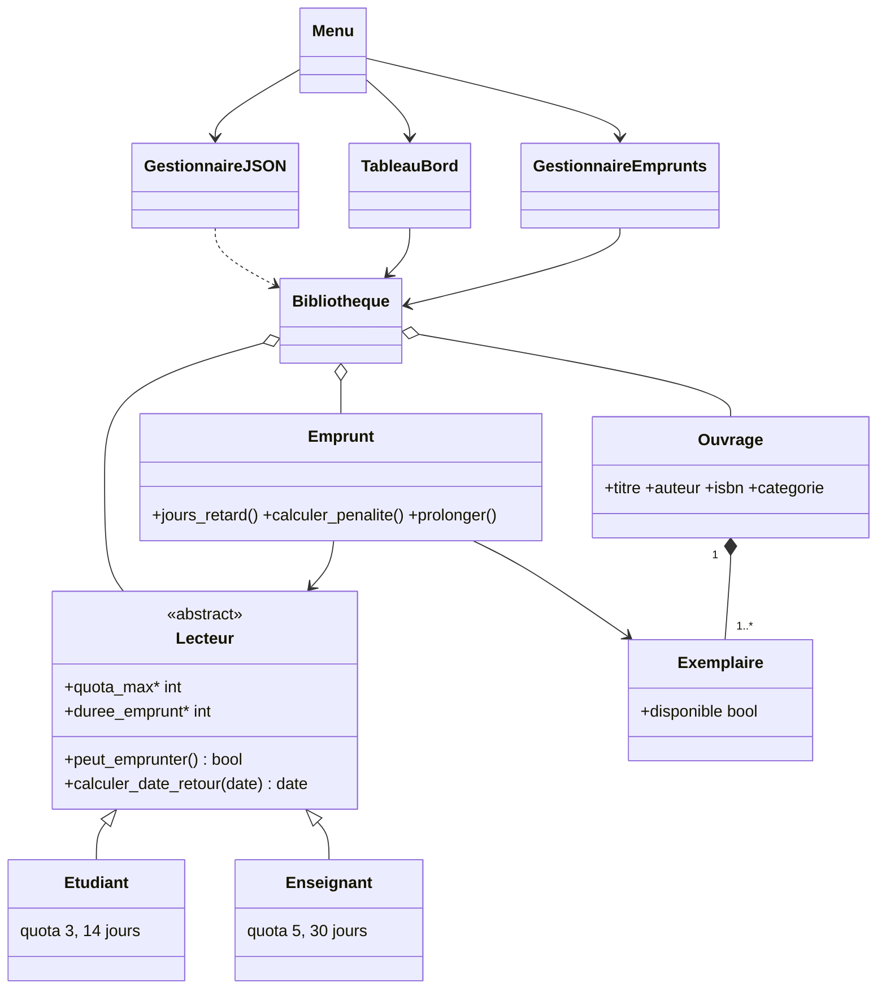

# Mini-projet 1 — Gestion d'une bibliothèque universitaire

Application Python orientée objet de gestion des prêts d'une bibliothèque
universitaire : catalogue d'ouvrages et d'exemplaires, lecteurs (étudiants et
enseignants), emprunts, retours, prolongations, retards et pénalités, tableau
de bord, persistance JSON et menu en console.


## Sommaire

- [Objectifs](#objectifs)
- [Fonctionnalités](#fonctionnalités)
- [Technologies utilisées](#technologies-utilisées)
- [Architecture des dossiers](#architecture-des-dossiers)
- [Installation](#installation)
- [Exécution](#exécution)
- [Tests](#tests)
- [Exemples d'utilisation](#exemples-dutilisation)
- [Diagramme de classes](#diagramme-de-classes)
- [Documentation](#documentation)
- [Auteur](#auteur)

## Objectifs

- Concevoir une application complète selon les principes de la
  programmation orientée objet (classe abstraite, héritage, polymorphisme,
  encapsulation, exceptions personnalisées).
- Appliquer des règles de gestion réelles : quotas et durées de prêt par
  type de lecteur, prolongation unique, pénalités de retard.
- Garantir la persistance des données et leur résistance aux incidents
  (fichier absent, corrompu, arrêt brutal).
- Vérifier le comportement par des tests unitaires automatisés.

## Fonctionnalités

| Domaine | Fonctionnalités |
|---|---|
| **Ouvrages** | Ajout, modification, suppression ; recherche par titre, auteur, catégorie (partielle, insensible à la casse) ou ISBN (exacte) ; plusieurs exemplaires par ouvrage ; disponibilité de chaque exemplaire ; contrôle de la clé ISBN-10/13 |
| **Lecteurs** | Classe abstraite `Lecteur` ; `Etudiant` (3 prêts, 14 jours) et `Enseignant` (5 prêts, 30 jours) ; inscription, modification, suppression, fiche avec prêts en cours |
| **Prêts** | Emprunt avec vérification de la disponibilité, du quota, des retards et des doublons ; retour (par emprunt ou par exemplaire) ; prolongation unique ; retards et pénalités de **100 FCFA par jour** |
| **Tableau de bord** | Ouvrages les plus empruntés, lecteurs en retard, nombre d'ouvrages et d'exemplaires (disponibles / empruntés), taux d'occupation, pénalités |
| **Persistance** | Sauvegarde JSON automatique après chaque modification ; chargement au démarrage ; identifiants et historique conservés ; écriture atomique, copie `.bak`, fichiers corrompus mis de côté et restaurés |
| **Interface** | Menu console en 9 entrées ; toutes les saisies contrôlées (choix, nombres, dates, ISBN) ; aucun plantage sur saisie incorrecte |

Règles complémentaires : le jour de l'échéance n'est pas en retard ; un lecteur
en retard ne peut plus emprunter ; un prêt en retard ne peut pas être
prolongé ; un ouvrage ou un lecteur ayant un prêt en cours ne peut pas être
supprimé. Taux d'occupation = exemplaires empruntés / total × 100.

## Technologies utilisées

- **Python 3.10+**, bibliothèque standard uniquement (`abc`, `json`,
  `datetime`, `argparse`, `unittest`…)
- **unittest** pour les tests, **pycodestyle** pour la vérification PEP 8
  (facultatif)
- **Git / GitHub** pour le versionnement
- Pour la documentation uniquement : **matplotlib** (diagramme PNG) et
  **reportlab** (rapport PDF)

## Architecture des dossiers

```
mini-projet-1-bibliotheque-universitaire/
├── main.py                         # point d'entrée
├── requirements.txt                # aucune dépendance obligatoire
├── data/                           # données JSON (jeu de démonstration)
│   ├── ouvrages.json
│   ├── lecteurs.json
│   └── emprunts.json
├── src/
│   ├── models/                     # entités métier
│   │   ├── ouvrage.py              #   Ouvrage (notice + exemplaires)
│   │   ├── exemplaire.py           #   Exemplaire (copie physique)
│   │   ├── lecteur.py              #   Lecteur (classe abstraite)
│   │   ├── etudiant.py             #   Etudiant(Lecteur)
│   │   ├── enseignant.py           #   Enseignant(Lecteur)
│   │   ├── emprunt.py              #   Emprunt (retards, pénalités)
│   │   └── validation.py           #   contrôles communs (ISBN…)
│   ├── services/
│   │   ├── bibliotheque.py         #   catalogue, lecteurs, identifiants
│   │   ├── gestionnaire_emprunts.py#   emprunt, retour, prolongation
│   │   └── tableau_bord.py         #   indicateurs
│   ├── persistence/
│   │   └── gestionnaire_json.py    #   sauvegarde / chargement JSON
│   ├── exceptions/
│   │   └── exceptions_personnalisees.py
│   └── interface/
│       ├── console.py              #   saisies contrôlées
│       └── menu.py                 #   menu interactif
├── tests/                          # 62 tests unittest
├── scripts/
│   ├── generer_donnees_demo.py     # (ré)génère le jeu de démonstration
│   ├── generer_diagramme.py        # diagramme UML en PNG
│   └── generer_rapport_pdf.py      # rapport Markdown -> PDF
└── docs/
    ├── rapport.md / rapport.pdf    # rapport technique (7 pages)
    ├── diagramme_classes.mmd       # diagramme UML (Mermaid)
    └── diagramme_classes.png
```

## Installation

Prérequis : Python 3.10 ou plus récent et Git.

```bash
git clone https://github.com/marcelalle-dev/mini-projet-1-bibliotheque-universitaire.git
cd mini-projet-1-bibliotheque-universitaire
```

Aucune bibliothèque externe n'est nécessaire. Un environnement virtuel reste
possible :

```bash
python -m venv .venv
# Windows : .venv\Scripts\activate    Linux/macOS : source .venv/bin/activate
pip install -r requirements.txt     # n'installe rien d'obligatoire
```

## Exécution

```bash
python main.py                    # utilise les données de ./data
python main.py --data autre_dossier
```

Les données de démonstration fournies ont des dates calculées par rapport à
leur jour de génération. Pour la soutenance, régénérez-les afin d'avoir des
prêts en cours et en retard à la date du jour :

```bash
python scripts/generer_donnees_demo.py --force
```

Le jeu contient 13 ouvrages (33 exemplaires), 6 étudiants, 3 enseignants et
25 emprunts, dont 15 en cours et 4 en retard. Personnes et ISBN sont fictifs.

## Tests

```bash
python -m unittest discover -s tests -t . -v
```

Résultat attendu : `Ran 62 tests ... OK`.

| Module | Tests | Contenu |
|---|---|---|
| `test_ouvrages.py` | 18 | création, ISBN, modification, suppression, recherches, exemplaires |
| `test_lecteurs.py` | 10 | classe abstraite, héritage, polymorphisme, quotas, sérialisation |
| `test_emprunts.py` | 20 | emprunt, indisponibilité, quotas, retards, retour, prolongation, pénalités |
| `test_persistence.py` | 7 | sauvegarde/restauration, fichiers absents ou corrompus |
| `test_tableau_bord.py` | 7 | indicateurs, menu piloté par saisies simulées |

Vérification PEP 8 (facultative) :

```bash
pip install pycodestyle
python -m pycodestyle src tests scripts main.py
```

## Exemples d'utilisation

Menu principal :

```
==============================================================================
 BIBLIOTHÈQUE UNIVERSITAIRE — MENU PRINCIPAL (26/11/2026)
==============================================================================
   1. Gestion des ouvrages
   2. Gestion des lecteurs
   3. Gestion des emprunts
   4. Retour d'un ouvrage
   5. Prolongation d'un emprunt
   6. Tableau de bord
   7. Historique des emprunts
   8. Sauvegarder les données
   9. Quitter
```

Refus d'un emprunt (quota atteint, ouvrage indisponible) :

```
Identifiant du lecteur : LEC-0001
[i] Arnaud HOUNKPATIN : 3/3 emprunts en cours.
Identifiant de l'ouvrage : OUV-0005
[ERREUR] Arnaud HOUNKPATIN a atteint son quota de 3 emprunts simultanés (Étudiant).

Identifiant du lecteur : LEC-0004
Identifiant de l'ouvrage : OUV-0004
[ERREUR] L'ouvrage « Bases de données » (OUV-0004) n'a aucun exemplaire disponible.
```

Retour en retard et prolongations :

```
Identifiant de l'emprunt (EMP-...) ou de l'exemplaire (OUV-...-E..) : EMP-0013
[OK] Retour enregistré : OUV-0007-E01 (« Statistique et probabilités »).
[i] Retard de 11 jour(s) : pénalité de 1100 FCFA à régler.

Identifiant de l'emprunt (EMP-...) : EMP-0021
[OK] Emprunt prolongé jusqu'au 20/01/2027 (prolongation unique utilisée).
Identifiant de l'emprunt (EMP-...) : EMP-0021
[ERREUR] L'emprunt EMP-0021 a déjà été prolongé une fois.
```

Tableau de bord (extrait) :

```
FONDS DOCUMENTAIRE
  Ouvrages (titres distincts) : 13
  Exemplaires au total        : 33
  Exemplaires disponibles     : 18
  Exemplaires empruntés       : 15
  Taux d'occupation du fonds  : 45.45 %

TOP 5 DES OUVRAGES LES PLUS EMPRUNTÉS
  1. Apprendre à programmer avec Python 3 [OUV-0001] — 6 emprunt(s)
  2. Introduction à l'algorithmique [OUV-0002] — 4 emprunt(s)
  ...
LECTEURS EN RETARD
  - Yao KOFFI [LEC-0003] : EMP-0013 (11 j), EMP-0014 (6 j) → 1700 FCFA
```

Utilisation des services depuis Python :

```python
from src.services import Bibliotheque, GestionnaireEmprunts

biblio = Bibliotheque()
ouvrage = biblio.ajouter_ouvrage("Algèbre linéaire", "Joseph Grifone",
                                 "9782100001064", "Mathématiques", 2)
etudiant = biblio.inscrire_etudiant("Dossou", "Aïcha")
prets = GestionnaireEmprunts(biblio)
emprunt = prets.emprunter(etudiant.id_lecteur, ouvrage.id_ouvrage)
print(emprunt.date_retour_prevue)        # aujourd'hui + 14 jours
```

## Diagramme de classes



Diagramme complet : [`docs/diagramme_classes.md`](docs/diagramme_classes.md) (rendu GitHub), [`docs/diagramme_classes.mmd`](docs/diagramme_classes.mmd)
et [`docs/diagramme_classes.png`](docs/diagramme_classes.png).

## Documentation

- Rapport technique : [`docs/rapport.pdf`](docs/rapport.pdf) (7 pages) et sa
  source [`docs/rapport.md`](docs/rapport.md)
- Régénérer le diagramme et le rapport (nécessite matplotlib et reportlab) :

```bash
python scripts/generer_diagramme.py
python scripts/generer_rapport_pdf.py
```

## Auteur

**ALLE Sourou Marcel**

Réalisé avec l'assistance de Claude Code (outil d'IA), mentionné en co-auteur
des commits.
