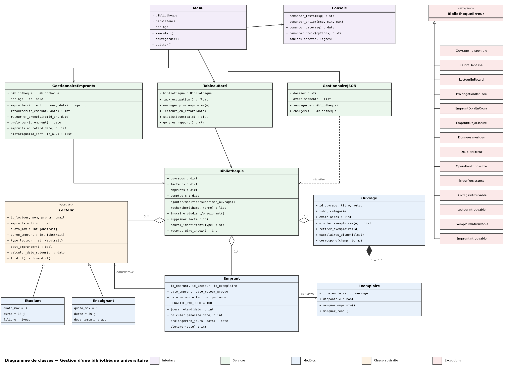

# Mini-projet 1

## Gestion d'une bibliothèque universitaire

Rapport technique

Application Python orientée objet de gestion des prêts, avec persistance JSON et tests automatisés

**Auteur :** ALLE Sourou Marcel

**Dépôt :** https://github.com/marcelalle-dev/mini-projet-1-bibliotheque-universitaire

Novembre 2026

<!-- pagebreak -->

## 1. Présentation du projet

Ce projet consiste à concevoir et réaliser une application complète de gestion des prêts d'une bibliothèque universitaire. L'application, écrite en Python et organisée selon les principes de la programmation orientée objet, permet de gérer le catalogue (ouvrages et exemplaires), les lecteurs (étudiants et enseignants) et l'ensemble du cycle de vie d'un prêt : emprunt, retour, prolongation, calcul des retards et des pénalités.

Les données sont conservées au format JSON et rechargées au démarrage, de sorte que l'application retrouve son état après fermeture. L'utilisateur interagit avec un menu en console dont toutes les saisies sont contrôlées. Le comportement de l'application est vérifié par une suite de 62 tests unitaires écrits avec `unittest`.

Le projet n'utilise que la bibliothèque standard de Python (version 3.10 ou supérieure) : aucune installation de dépendance n'est nécessaire pour l'exécuter ou le tester.

## 2. Analyse des besoins

### 2.1 Besoins fonctionnels

- **Ouvrages** : ajout, modification, suppression ; recherche par titre, auteur, catégorie ou ISBN ; gestion de plusieurs exemplaires par ouvrage et consultation de leur disponibilité.
- **Lecteurs** : inscription, modification, suppression et consultation des étudiants et des enseignants, chacun avec ses propres règles de prêt.
- **Prêts** : emprunt après vérification de la disponibilité et du quota, retour, prolongation unique, calcul des retards et des pénalités.
- **Tableau de bord** : ouvrages les plus empruntés, lecteurs en retard, nombre d'ouvrages et d'exemplaires (disponibles, empruntés), taux d'occupation du fonds.
- **Persistance** : sauvegarde et chargement de toutes les données, historique des emprunts compris.
- **Interface** : menu en console clair, sans plantage en cas de saisie incorrecte.

### 2.2 Règles de gestion

| Règle | Étudiant | Enseignant |
|---|---|---|
| Emprunts simultanés maximum | 3 | 5 |
| Durée d'un emprunt | 14 jours | 30 jours |
| Prolongation | une fois, de 14 jours | une fois, de 30 jours |
| Pénalité de retard | 100 FCFA par jour | 100 FCFA par jour |

Règles complémentaires retenues lors de l'analyse :

- le jour de l'échéance n'est pas compté en retard ; le retard commence le lendemain ;
- un lecteur ayant un prêt en retard ne peut pas emprunter tant qu'il ne l'a pas rendu ;
- un lecteur ne peut pas détenir deux exemplaires du même ouvrage ;
- un prêt déjà en retard ne peut pas être prolongé ;
- un ouvrage (ou un lecteur) ne peut pas être supprimé tant qu'un de ses prêts est en cours ;
- la pénalité d'un prêt rendu est figée à la date de retour ;
- taux d'occupation = exemplaires empruntés / total des exemplaires × 100.

### 2.3 Besoins non fonctionnels

Au moins six classes dont une classe abstraite et une hiérarchie d'héritage, des exceptions personnalisées (dont `OuvrageIndisponible` et `QuotaDepasse`), un code réparti en modules avec un point d'entrée `main.py`, au moins quinze tests unitaires, le respect de la PEP 8, des docstrings pour toutes les classes et méthodes publiques, et un historique Git.

## 3. Architecture logicielle

L'application est organisée en couches. Chaque couche ne dépend que des couches situées en dessous d'elle, ce qui permet de tester les règles métier sans passer par la console.

| Couche | Paquet | Rôle |
|---|---|---|
| Interface | `src/interface` | Menu console et saisies contrôlées (`Menu`, `Console`) |
| Services | `src/services` | Règles métier (`Bibliotheque`, `GestionnaireEmprunts`, `TableauBord`) |
| Persistance | `src/persistence` | Lecture et écriture JSON (`GestionnaireJSON`) |
| Modèles | `src/models` | Entités (`Ouvrage`, `Exemplaire`, `Lecteur`, `Etudiant`, `Enseignant`, `Emprunt`) |
| Exceptions | `src/exceptions` | Hiérarchie d'erreurs métier (`BibliothequeErreur` et 14 sous-classes) |

```
mini-projet-1-bibliotheque-universitaire/
├── main.py                     point d'entrée
├── data/                       ouvrages.json, lecteurs.json, emprunts.json
├── src/
│   ├── models/                 ouvrage, exemplaire, lecteur, etudiant,
│   │                           enseignant, emprunt, validation
│   ├── services/               bibliotheque, gestionnaire_emprunts,
│   │                           tableau_bord
│   ├── persistence/            gestionnaire_json
│   ├── exceptions/             exceptions_personnalisees
│   └── interface/              console, menu
├── tests/                      5 modules de tests + utilitaires
├── scripts/                    données de démonstration, diagramme, PDF
└── docs/                       rapport, diagramme de classes
```

La classe `Bibliotheque` détient l'état de l'application : trois dictionnaires indexés par identifiant (ouvrages, lecteurs, emprunts) et les compteurs d'identifiants. `GestionnaireEmprunts` et `TableauBord` opèrent sur cette instance, et `GestionnaireJSON` la sérialise. Le `Menu` relie ces services à l'utilisateur.

<!-- pagebreak -->

## 4. Diagramme de classes UML



Le diagramme source est disponible au format Mermaid dans `docs/diagramme_classes.mmd` (rendu automatiquement par GitHub). Les points essentiels sont :

- **Héritage** : `Etudiant` et `Enseignant` héritent de la classe abstraite `Lecteur` ; les 14 exceptions héritent de `BibliothequeErreur`.
- **Composition** : un `Ouvrage` possède un ou plusieurs `Exemplaire` ; un exemplaire n'existe pas sans son ouvrage.
- **Agrégation** : la `Bibliotheque` regroupe ouvrages, lecteurs et emprunts.
- **Association** : un `Emprunt` relie un `Lecteur` à un `Exemplaire` précis.

## 5. Choix techniques

**Classe abstraite et polymorphisme.** `Lecteur` hérite de `abc.ABC` et déclare trois propriétés abstraites : `quota_max`, `duree_emprunt` et `type_lecteur`. Les services n'utilisent jamais de test du type `isinstance(lecteur, Etudiant)` : ils appellent `lecteur.peut_emprunter()` ou `lecteur.calculer_date_retour(date)`, et chaque sous-classe fournit ses propres valeurs. Ajouter un nouveau type de lecteur (personnel administratif, par exemple) ne demande qu'une nouvelle sous-classe.

**Sérialisation polymorphe.** Chaque sous-classe déclare une constante `TYPE` et s'enregistre automatiquement auprès de `Lecteur` grâce à `__init_subclass__`. `Lecteur.from_dict()` lit le champ `type` du JSON et instancie la bonne sous-classe, sans chaîne de `if`.

**Ouvrage et exemplaire.** L'ouvrage est la notice bibliographique (titre, auteur, ISBN, catégorie) ; l'exemplaire est la copie physique qui porte l'état « disponible ». Un emprunt référence un exemplaire précis, ce qui permet de savoir quelle copie est chez quel lecteur. Les identifiants d'exemplaires (`OUV-0001-E03`) ne sont jamais réattribués, même après le retrait d'une copie.

**Identifiants persistants.** Les identifiants (`OUV-0007`, `LEC-0003`, `EMP-0025`) proviennent de compteurs sauvegardés avec les données : un identifiant supprimé n'est jamais réutilisé, ce qui préserve la cohérence de l'historique.

**Horloge injectable.** `GestionnaireEmprunts` et `TableauBord` reçoivent une fonction `horloge` (par défaut `date.today`). Les tests et le générateur de données de démonstration lui substituent une horloge simulée, ce qui rend déterministes les calculs de retard et de pénalité.

**Exceptions personnalisées.** Toutes les erreurs métier héritent de `BibliothequeErreur`. L'interface intercepte cette seule classe de base pour afficher le message, tandis que les erreurs de programmation (`TypeError`, etc.) ne sont pas masquées. Les exceptions portent un contexte utile : `QuotaDepasse.lecteur`, `OuvrageIndisponible.ouvrage`, `LecteurEnRetard.nb_retards`.

**Validation.** Les champs obligatoires sont vérifiés à la création et à la modification ; une modification invalide ne change aucun champ (validation complète avant affectation). La clé de contrôle des ISBN-10 et ISBN-13 est vérifiée.

**Persistance robuste.** Trois fichiers JSON lisibles (UTF-8, indentés). Chaque écriture passe par un fichier temporaire remplacé atomiquement (`os.replace`), et la version précédente est conservée en `.bak`. Au chargement, un fichier absent donne une collection vide ; un fichier corrompu est renommé (`.corrompu-<date>`) puis remplacé par sa sauvegarde si elle est valide. Enfin, `reconstruire_index()` recalcule la disponibilité des exemplaires et les prêts en cours de chaque lecteur à partir des emprunts, qui font foi.

**Interface testable.** `Console` reçoit ses fonctions d'entrée et de sortie en paramètre. Les tests pilotent ainsi le menu avec des saisies simulées.

## 6. Présentation des fonctionnalités

Le menu principal propose neuf entrées : gestion des ouvrages, gestion des lecteurs, gestion des emprunts, retour, prolongation, tableau de bord, historique, sauvegarde et quitter. Chaque opération qui modifie les données déclenche une sauvegarde automatique ; quitter (option 9, Ctrl+C ou fin de l'entrée standard) sauvegarde également.

- **Ouvrages** : liste avec disponibilité (`2/3`), recherche partielle et insensible à la casse par titre, auteur ou catégorie, recherche exacte par ISBN (tirets ignorés), fiche détaillée indiquant pour chaque exemplaire l'emprunteur et la date de retour prévue, ajout ou retrait d'exemplaires.
- **Lecteurs** : inscription d'étudiants (filière, niveau) et d'enseignants (département, grade), fiche lecteur avec prêts en cours et pénalité due à ce jour.
- **Emprunts** : l'emprunt vérifie, dans l'ordre, l'existence du lecteur et de l'ouvrage, l'absence de retard, le quota, l'absence de doublon et la disponibilité ; un message explicite est affiché en cas de refus.
- **Retour** : par identifiant d'emprunt ou d'exemplaire, avec affichage du retard et de la pénalité.
- **Saisies contrôlées** : choix de menu redemandé s'il est invalide, entiers bornés, dates au format JJ/MM/AAAA (dates impossibles refusées), ISBN redemandé jusqu'à ce que sa clé soit correcte, confirmation des suppressions, champ vide pour annuler.

Extrait du tableau de bord obtenu avec les données de démonstration (situation au 26/11/2026) :

```
FONDS DOCUMENTAIRE
  Ouvrages (titres distincts) : 13
  Exemplaires au total        : 33
  Exemplaires disponibles     : 18
  Exemplaires empruntés       : 15
  Taux d'occupation du fonds  : 45.45 %
LECTEURS EN RETARD
  - Yao KOFFI [LEC-0003] : EMP-0013 (11 j), EMP-0014 (6 j) → 1700 FCFA
  - Aïcha DOSSOU [LEC-0002] : EMP-0012 (16 j) → 1600 FCFA
  - Codjo AHOUANDJINOU [LEC-0007] : EMP-0011 (10 j) → 1000 FCFA
```

Le jeu de données de démonstration (13 ouvrages, 33 exemplaires, 6 étudiants, 3 enseignants, 25 emprunts dont 15 en cours et 4 en retard) est produit par `scripts/generer_donnees_demo.py`. Ce script rejoue un scénario chronologique à travers les vrais services avec une horloge simulée : les données respectent donc toutes les règles métier. Les dates étant calculées par rapport au jour de génération, il suffit de relancer le script avec `--force` avant la soutenance pour disposer de prêts en cours et en retard. Le jeu permet de montrer un quota atteint (LEC-0001), un ouvrage sans exemplaire disponible (OUV-0004), un lecteur bloqué pour retard (LEC-0007), un prêt déjà prolongé (EMP-0016) et des pénalités facturées dans l'historique.

## 7. Stratégie de tests et résultats

Les tests sont écrits avec `unittest`. Chaque test construit son propre contexte (bibliothèque en mémoire, dossier temporaire pour la persistance) et utilise une horloge simulée, ce qui les rend indépendants entre eux et de la date d'exécution. Les cas limites sont testés explicitement : jour de l'échéance, cinquième et sixième emprunt d'un enseignant, double retour, seconde prolongation.

| Module | Tests | Contenu |
|---|---|---|
| `test_ouvrages.py` | 18 | Création, ISBN, doublons, modification, suppression, recherches, exemplaires |
| `test_lecteurs.py` | 10 | Classe abstraite, étudiants, enseignants, polymorphisme, quotas, sérialisation |
| `test_emprunts.py` | 20 | Emprunt, indisponibilité, quotas, retards, retour, prolongation, pénalités |
| `test_persistence.py` | 7 | Sauvegarde/restauration, identifiants, fichiers absents ou corrompus |
| `test_tableau_bord.py` | 7 | Indicateurs, classement, retards, menu piloté par saisies simulées |
| **Total** | **62** | |

Commande et résultat obtenus :

```
> python -m unittest discover -s tests -t .
..............................................................
----------------------------------------------------------------------
Ran 62 tests in 0.264s

OK
```

La suite réussit sous Python 3.12.10 et 3.14.4. La conformité PEP 8 a été vérifiée avec `pycodestyle` 2.15.0 (aucun avertissement sur `src`, `tests`, `scripts` et `main.py`), et un script d'analyse syntaxique a confirmé qu'aucune classe ou méthode publique n'est dépourvue de docstring. L'application a en outre été exercée de bout en bout depuis `main.py` avec des saisies scriptées sur une copie des données de démonstration.

## 8. Difficultés rencontrées et solutions apportées

**Emprunts perdus au rechargement.** Lors du premier essai complet de l'application sur les données de démonstration, le tableau de bord n'affichait que 12 emprunts au lieu de 25. Le chargeur JSON déterminait l'identifiant d'un objet en testant successivement les attributs `id_ouvrage`, `id_lecteur` puis `id_emprunt` ; or un emprunt possède aussi un attribut `id_ouvrage`, si bien que les emprunts étaient indexés par ouvrage et s'écrasaient. Le test de persistance initial, avec un seul emprunt, ne pouvait pas le révéler. Correction : l'attribut identifiant de chaque type est déclaré explicitement. Le test de restauration crée désormais plusieurs emprunts du même ouvrage ; il a été rejoué contre l'ancienne version du chargeur et échoue bien, ce qui confirme qu'il protège contre une régression.

**Réattribution d'identifiants d'exemplaires.** Un premier essai a montré qu'après le retrait de l'exemplaire `E03`, l'ajout d'une copie recréait un `E03`, ce qui aurait mêlé l'historique de deux livres physiques différents. Un compteur `dernier_numero`, sauvegardé avec l'ouvrage, garantit désormais des numéros uniques.

**ISBN invalides dans les tests.** Au premier lancement de la suite, 52 tests sur 62 étaient en erreur : les ISBN saisis à la main dans les données de test avaient une clé de contrôle fausse et étaient, à juste titre, refusés par le validateur. Les clés ont été calculées par programme ; le générateur de démonstration calcule lui-même la clé de ses ISBN.

**Ergonomie de la saisie.** Lors des essais du menu, un ISBN invalide n'était signalé qu'après la saisie de tous les champs, et les tableaux tronquaient trop les colonnes. L'ISBN est maintenant validé et redemandé immédiatement, les tableaux peuvent occuper 100 colonnes et les dates y sont abrégées (JJ/MM/AA).

**Encodage de la console.** Sous Windows, lorsque la sortie est redirigée, les caractères accentués des messages pouvaient s'afficher de façon dégradée. `main.py` reconfigure les flux de sortie en mode `errors="replace"` afin qu'un caractère non affichable ne puisse jamais interrompre l'application.

**Dates des données de démonstration.** Des données à dates fixes deviendraient toutes « en retard » avec le temps. Le générateur calcule les dates par rapport au jour de son exécution et refuse d'écraser des données existantes sans l'option `--force`.

## 9. Répartition du travail

Le projet a été réalisé par ALLE Sourou Marcel, avec l'assistance d'un outil d'intelligence artificielle (Claude Code), utilisé pour la conception, l'écriture du code, des tests et de la documentation. Cette assistance apparaît dans l'historique Git sous la forme d'une ligne `Co-Authored-By` dans chaque commit. Aucune autre contribution n'est revendiquée dans ce rapport.

| Étape (commit) | Contenu |
|---|---|
| Initialisation, architecture | Dépôt, `.gitignore`, arborescence, exceptions |
| Modèles | Ouvrage, Exemplaire, Lecteur, Etudiant, Enseignant, Emprunt |
| Services | Bibliotheque, GestionnaireEmprunts, TableauBord |
| Persistance | GestionnaireJSON et correction du rechargement |
| Interface, données | Menu, Console, `main.py`, jeu de démonstration |
| Tests, corrections | 62 tests unitaires, PEP 8, docstrings |
| Documentation | README, rapport, diagramme UML |

Si le projet est présenté en équipe, chaque membre peut compléter ce tableau avec les tâches qu'il a effectivement réalisées ; l'historique Git (`git log`) fait foi des contributions.

## 10. Conclusion

L'application répond à l'ensemble du cahier des charges : gestion du catalogue et des exemplaires, hiérarchie de lecteurs fondée sur une classe abstraite, règles de prêt complètes, tableau de bord, persistance JSON résistante aux fichiers absents ou corrompus, et interface console aux saisies contrôlées. Les 62 tests unitaires réussissent et le code respecte la PEP 8.

Le projet a surtout montré l'intérêt des tests conçus pour pouvoir échouer : le défaut de rechargement des emprunts n'a été détecté que par un essai réaliste, puis verrouillé par un test adapté. Parmi les évolutions possibles : réservation d'un ouvrage indisponible, enregistrement du paiement des pénalités, export du tableau de bord en CSV, ou remplacement du stockage JSON par SQLite pour un volume de données plus important.
